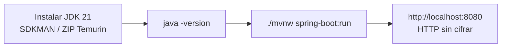

# Laboratorio 0: instalar Java 21 y levantar el sitio de prueba

Antes de crear la PKI, prepararemos el sitio de prueba **Cobalt Forge** (`web-java/`): una aplicación **Spring Boot** mínima que devuelve una página web. Más adelante la serviremos por HTTPS con un certificado emitido por nuestra propia CA.

Solo se necesita un **JDK 21**. No hace falta instalar Maven: el proyecto incluye el **Maven Wrapper** (`mvnw` / `mvnw.cmd`), que descarga la versión correcta de Maven la primera vez que se ejecuta.

## 1. macOS con SDKMAN

### 1.1. Instalar SDKMAN (si no lo tienes)

```bash
curl -s "https://get.sdkman.io" | bash
source "$HOME/.sdkman/bin/sdkman-init.sh"
sdk version
```

### 1.2. Instalar Java 21

Ver las distribuciones disponibles y elegir una versión 21 (por ejemplo Temurin, `-tem`, o Zulu, `-zulu`):

```bash
sdk list java | grep -E ' 21\.'
sdk install java 21.0.x-tem      # reemplaza por el identificador exacto de la lista
```

Si tienes varias versiones instaladas, selecciona la 21:

```bash
sdk use java 21.0.x-tem          # solo en esta terminal
sdk default java 21.0.x-tem      # por defecto en terminales nuevas
```

### 1.3. Probar

```bash
java -version
echo $JAVA_HOME
```

Resultado esperado (el proveedor puede variar):

```text
openjdk version "21.0.x" ...
/Users/<usuario>/.sdkman/candidates/java/current
```

## 2. Windows con el ZIP de Temurin

Instalaremos el JDK de forma **portable** en `%USERPROFILE%\Programs\Java`, sin permisos de administrador.

### 2.1. Descargar

1. Entra a <https://adoptium.net/temurin/releases/?version=21&os=windows&arch=x64&package=jdk>.
2. Descarga el **JDK 21, Windows x64, `.zip`** (no el `.msi`).

### 2.2. Extraer en `%USERPROFILE%\Programs\Java`

En **PowerShell**, ajustando el nombre del ZIP:

```powershell
$java = "$env:USERPROFILE\Programs\Java"

New-Item -ItemType Directory -Force -Path $java | Out-Null

Expand-Archive `
  -Path "$env:USERPROFILE\Downloads\OpenJDK21U-jdk_x64_windows_hotspot_21.0.x_y.zip" `
  -DestinationPath $java `
  -Force

Get-ChildItem $java
```

Quedará una carpeta como `jdk-21.0.x+y` con `bin\java.exe` dentro.

### 2.3. Definir `JAVA_HOME` y el `PATH` del usuario

```powershell
$jdk = (Get-ChildItem $java -Directory -Filter "jdk-21*" | Select-Object -First 1).FullName

[Environment]::SetEnvironmentVariable("JAVA_HOME", $jdk, "User")

$userPath = [Environment]::GetEnvironmentVariable("Path", "User")
if (($userPath -split ";") -notcontains "%JAVA_HOME%\bin") {
  [Environment]::SetEnvironmentVariable("Path", "$userPath;%JAVA_HOME%\bin", "User")
}
```

Los cambios son permanentes y solo para tu usuario. **Cierra y vuelve a abrir** la terminal para que surtan efecto.

> **Alternativa gráfica:** menú Inicio → *Editar las variables de entorno de esta cuenta* → **Nueva** `JAVA_HOME` = carpeta del JDK; luego en `Path` → **Nuevo** → `%JAVA_HOME%\bin`.

### 2.4. Probar

En una terminal **nueva**:

```powershell
java -version
echo $env:JAVA_HOME
where.exe java
```

| Problema | Causa probable |
|---|---|
| `java : The term 'java' is not recognized` | La terminal se abrió antes de cambiar el `PATH`, o `JAVA_HOME` no apunta a la carpeta que contiene `bin\java.exe`. |
| `java -version` muestra otra versión | Hay otro Java antes en el `PATH` (por ejemplo, en el `PATH` del sistema). Revisa `where.exe java`. |
| `mvnw.cmd`: `JAVA_HOME not found` | `JAVA_HOME` no está definido o apunta a una carpeta incorrecta. |

## 3. Levantar el sitio de prueba

Desde el directorio `web-java/` del proyecto:

```bash
cd web-java
./mvnw spring-boot:run          # macOS
```

```powershell
cd web-java
.\mvnw.cmd spring-boot:run      # Windows
```

La primera ejecución tarda más: descarga Maven y las dependencias a `~/.m2`. Cuando aparezca `Started CobaltForgeApplication`, abre <http://localhost:8080>.

Deberías ver la página **Hello, World** de Cobalt Forge con el protocolo marcado como **HTTP** (en naranja). Detén la aplicación con `Ctrl+C`.



### Estructura de la aplicación

| Ruta en `web-java/` | Contenido |
|---|---|
| `pom.xml` | Proyecto Spring Boot, Java 21 |
| `src/main/java/.../HomeController.java` | Atiende `GET /` y detecta si la petición llegó por HTTPS |
| `src/main/resources/templates/index.html` | Página (Thymeleaf) |
| `src/main/resources/static/` | CSS (Pico CSS + `theme.css`), fuentes y logo |
| `src/main/resources/application.yml` | Configuración: por ahora, puerto 8080 sin TLS |

> Por ahora la aplicación solo habla **HTTP**. Cuando el tutorial llegue al certificado de servidor, configuraremos HTTPS en `application.yml` usando los archivos de `cert/`.

## 4. Siguiente laboratorio

[Crear la Root CA](01-root-ca-x509-openssl-macos.md): la autoridad raíz que, al final, hará que el navegador confíe en nuestro sitio.

## Referencias oficiales

- [SDKMAN — Instalación](https://sdkman.io/install/)
- [Eclipse Temurin — Descargas](https://adoptium.net/temurin/releases/)
- [Spring Boot — Running your application](https://docs.spring.io/spring-boot/how-to/index.html)
- [Maven Wrapper](https://maven.apache.org/tools/wrapper/)
