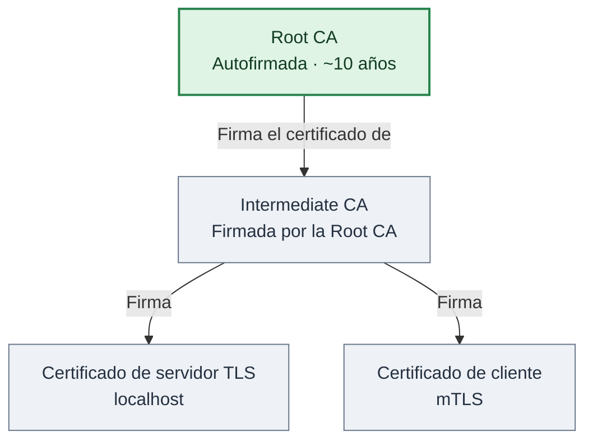
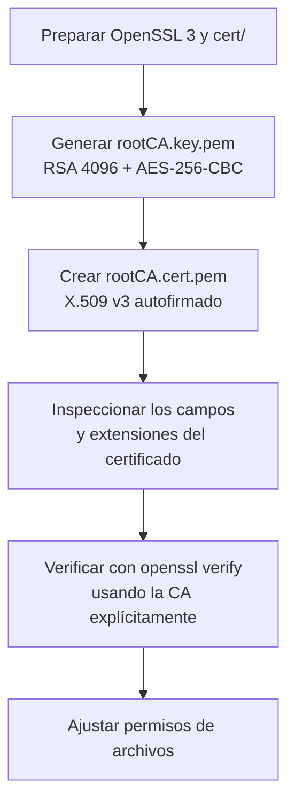
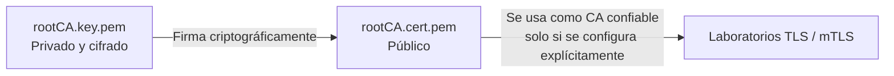

# Laboratorio: crear una Root CA X.509 con OpenSSL en macOS

Este laboratorio muestra cómo crear una **autoridad certificadora raíz (Root CA) autofirmada** con OpenSSL en macOS, revisar su certificado y verificarlo sin instalarlo como autoridad confiable del sistema.

**Características del laboratorio:**

- Algoritmo de la clave privada: **RSA de 4096 bits**.
- Protección de la clave privada: **AES-256-CBC**, con contraseña.
- Algoritmo de firma del certificado: **SHA-256 con RSA**.
- Duración: **3650 días** (aproximadamente 10 años).
- Certificado: **X.509 v3**, apto para actuar como CA.

> **Importante:** este procedimiento es **solo para aprendizaje**. Una CA real exige políticas adicionales de seguridad, custodia de claves, revocación, auditoría y procedimientos operativos. Nunca publiques `rootCA.key.pem`.

## 1. Preparar OpenSSL en macOS

macOS puede incluir LibreSSL bajo el comando `openssl`. Para este laboratorio, instalaremos OpenSSL 3 mediante Homebrew:

```bash
brew install openssl@3
```

Elegimos explícitamente el ejecutable instalado por Homebrew:

```bash
export OPENSSL="$(brew --prefix openssl@3)/bin/openssl"

$OPENSSL version
```

> La variable `OPENSSL` se mantiene en la sesión actual del terminal. Si abres una terminal nueva, deberás volver a definirla.

## 2. Preparar el directorio `cert/`

Todos los comandos de este laboratorio se ejecutan **desde la raíz del proyecto** y escriben su salida en `cert/`. Si el directorio no existe, se crea:

```bash
cd /ruta/al/proyecto      # raíz del repositorio
mkdir -p cert

umask 077
```

`umask 077` restringe los permisos de los archivos nuevos, de modo que, inicialmente, solo su propietario pueda acceder a ellos.

> El contenido de `cert/` está excluido de Git mediante `.gitignore`: las claves y certificados se generan localmente y nunca se suben al repositorio.

## 3. Generar la clave privada de la Root CA

```bash
$OPENSSL genpkey \
  -algorithm RSA \
  -aes-256-cbc \
  -pkeyopt rsa_keygen_bits:4096 \
  -out cert/rootCA.key.pem
```

OpenSSL pedirá una **contraseña** para cifrar la clave privada.

El archivo `rootCA.key.pem` **debe permanecer secreto**. Es la clave con la que la CA firmará certificados.

## 4. Crear el certificado raíz X.509 autofirmado

```bash
$OPENSSL req -new -x509 \
  -sha256 \
  -days 3650 \
  -key cert/rootCA.key.pem \
  -out cert/rootCA.cert.pem \
  -subj "/C=CO/ST=Bogota/L=Bogota/O=PKI Lab/CN=Lab Root CA" \
  -addext "basicConstraints=critical,CA:TRUE,pathlen:1" \
  -addext "keyUsage=critical,keyCertSign,cRLSign" \
  -addext "subjectKeyIdentifier=hash" \
  -addext "authorityKeyIdentifier=keyid:always"
```

Se solicitará la contraseña de `rootCA.key.pem`.

- `req -new -x509`: crea un certificado autofirmado directamente, en lugar de producir únicamente una CSR.
- `-sha256`: usa SHA-256 para la firma.
- `-days 3650`: fija la vigencia en 3650 días.
- `-key`: señala la clave privada que firma el certificado.
- `-out`: especifica el certificado público generado.
- `-subj`: establece la identidad de la CA: país (`C`), departamento/estado (`ST`), localidad (`L`), organización (`O`) y nombre común (`CN`).

### Extensiones X.509 v3

| Extensión | Función |
|---|---|
| `basicConstraints=critical,CA:TRUE,pathlen:1` | Indica que es una CA y permite como máximo **un nivel de CA subordinada** debajo de esta raíz en una cadena de certificados. |
| `keyUsage=critical,keyCertSign,cRLSign` | Permite firmar certificados y listas de revocación (CRL). |
| `subjectKeyIdentifier=hash` | Identifica la clave pública de la CA. |
| `authorityKeyIdentifier=keyid:always` | Identifica la clave de la CA emisora; en una raíz autofirmada corresponde a su propia clave. |

> Las extensiones marcadas como `critical` deben ser interpretadas por quienes validan los certificados. `pathlen:1` es apropiado para el esquema **Root CA → Intermediate CA → certificado final** que queremos explorar.

## 5. Inspeccionar el certificado

### Ver todos sus campos y extensiones

```bash
$OPENSSL x509 \
  -in cert/rootCA.cert.pem \
  -text \
  -noout
```

### Ver emisor, titular, serie y vigencia

```bash
$OPENSSL x509 \
  -in cert/rootCA.cert.pem \
  -noout \
  -issuer -subject -serial -dates
```

Como el certificado es **autofirmado**, `issuer` y `subject` corresponden a la misma CA.

### Ver la huella digital SHA-256

```bash
$OPENSSL x509 \
  -in cert/rootCA.cert.pem \
  -noout \
  -fingerprint \
  -sha256
```

La huella permite comparar la identidad del certificado en dos ubicaciones mediante un resumen criptográfico.

## 6. Verificar el certificado de la Root CA

```bash
$OPENSSL verify \
  -CAfile cert/rootCA.cert.pem \
  cert/rootCA.cert.pem
```

Resultado esperado:

```text
cert/rootCA.cert.pem: OK
```

> **Nota:** `-CAfile cert/rootCA.cert.pem` indica que estamos confiando **explícitamente** en este certificado para la prueba. **No** implica que macOS, Safari, Chrome u otros programas confíen ya en nuestra CA.

## 7. Proteger los archivos

```bash
chmod 400 cert/rootCA.key.pem
chmod 444 cert/rootCA.cert.pem

ls -l cert/
```

Los archivos resultantes son:

| Archivo (en `cert/`) | Contenido | Distribución |
|---|---|---|
| `rootCA.key.pem` | Clave privada RSA cifrada | **Nunca compartir** |
| `rootCA.cert.pem` | Certificado raíz X.509 público | Se puede distribuir a sistemas que deban confiar en esta CA |

No es necesario instalar el certificado en el llavero de macOS para realizar estas pruebas.

## 8. Diagramas Mermaid

### 8.1. Jerarquía PKI objetivo

En este primer ejercicio solo hemos creado la **Root CA**. Las demás piezas son pasos para laboratorios posteriores.



- **Root CA**: ancla de confianza, autofirmada.
- **Intermediate CA**: autoridad subordinada, que puede emitir certificados finales.
- **Certificado de servidor TLS**: identifica a un servidor.
- **Certificado de cliente mTLS**: puede autenticar a un cliente ante el servidor.

### 8.2. Flujo de creación y validación



### 8.3. Relación entre los archivos



## 9. Siguiente ejercicio sugerido

**Crear una Intermediate CA:** generar su clave privada y CSR (solicitud de firma), firmarla con `rootCA.key.pem` y `rootCA.cert.pem`, y construir una cadena de certificados. Después se pueden emitir certificados de servidor y cliente y probar **TLS/mTLS**.

La ventaja de esta jerarquía es que una Root CA puede mantenerse resguardada mientras la Intermediate CA realiza la emisión cotidiana de certificados.
