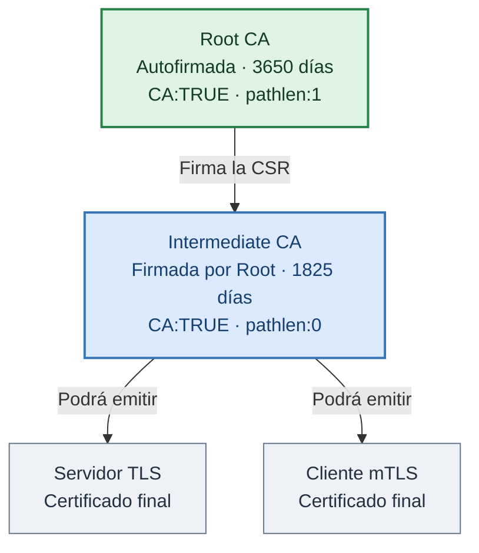
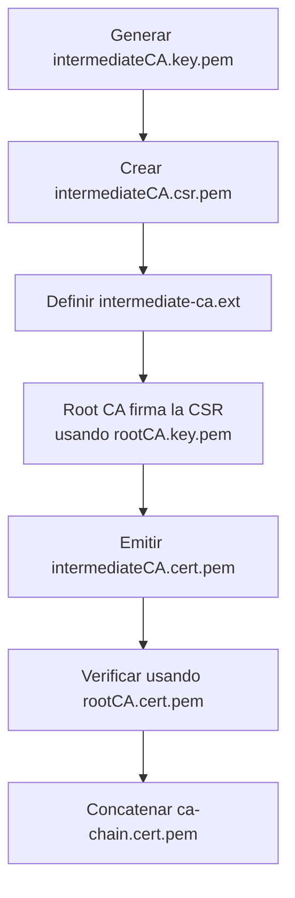
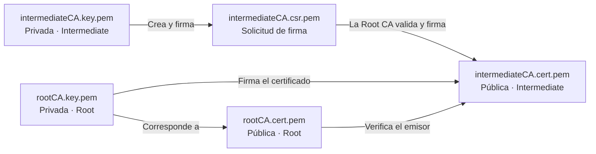

# Laboratorio: crear una Intermediate CA X.509 con OpenSSL en macOS

Este laboratorio continúa el ejercicio de la **Root CA** y crea una autoridad certificadora **intermedia** cuya solicitud de certificado (CSR) será firmada por la Root CA. Todos los comandos están pensados para **macOS con OpenSSL 3** y se ejecutan desde una terminal `zsh` o `bash`.

> **Requisito:** haber completado el laboratorio previo, con estos archivos existentes:
>
> - `cert/rootCA.key.pem` — clave privada de la Root CA, cifrada.
> - `cert/rootCA.cert.pem` — certificado autofirmado de la Root CA.
>
> **Solo para laboratorio.** Una PKI de producción requiere gestión formal de series, inventario de certificados emitidos, CRL/OCSP, políticas, protección y rotación de claves, y otros controles. La Root CA idealmente permanece fuera de línea.

## 1. Objetivo y jerarquía

La Root CA del ejercicio anterior tenía `basicConstraints=CA:TRUE,pathlen:1`; eso permite colocar **una Intermediate CA** debajo de ella. La nueva autoridad tendrá `pathlen:0`, de modo que podrá firmar certificados de servidor o cliente, pero no otras CAs subordinadas en una cadena válida.



Características de la Intermediate CA:

| Propiedad | Valor |
|---|---|
| Clave privada | RSA 4096 bits, cifrada con AES-256-CBC |
| Certificado | X.509 v3 |
| Firmado por | Root CA del laboratorio |
| Algoritmo de firma | SHA-256 con RSA |
| Vigencia | 1825 días (aproximadamente cinco años) |
| `basicConstraints` | `critical,CA:TRUE,pathlen:0` |
| `keyUsage` | `critical,keyCertSign,cRLSign` |

## 2. Preparar OpenSSL y el directorio

Si ya instalaste OpenSSL 3 con Homebrew, basta con seleccionar su ejecutable:

```bash
export OPENSSL="$(brew --prefix openssl@3)/bin/openssl"
$OPENSSL version
```

Igual que en el laboratorio anterior, todos los comandos se ejecutan **desde la raíz del proyecto** y escriben su salida en `cert/`. Si el directorio no existe, se crea, y se restringen los permisos de los nuevos archivos:

```bash
cd /ruta/al/proyecto      # raíz del repositorio
mkdir -p cert
umask 077
```

Verificar que la Root CA esté disponible:

```bash
ls -l cert/rootCA.key.pem cert/rootCA.cert.pem
```

La estructura inicial es:

```text
cert/
├── README.md
├── rootCA.key.pem
└── rootCA.cert.pem
```

## 3. Generar la clave privada de la Intermediate CA

```bash
$OPENSSL genpkey \
  -algorithm RSA \
  -aes-256-cbc \
  -pkeyopt rsa_keygen_bits:4096 \
  -out cert/intermediateCA.key.pem
```

OpenSSL solicitará la contraseña **nueva** para proteger esta clave. Puedes emplear una distinta de la Root CA.

**Importante:** `intermediateCA.key.pem` es una clave privada, no se debe distribuir. No se utiliza aquí la clave de la Root CA: cada CA tiene su propio par de claves.

## 4. Generar la CSR de la Intermediate CA

```bash
$OPENSSL req -new \
  -sha256 \
  -key cert/intermediateCA.key.pem \
  -out cert/intermediateCA.csr.pem \
  -subj "/C=CO/ST=Bogota/L=Bogota/O=PKI Lab/CN=Lab Intermediate CA"
```

La CSR (Certificate Signing Request) contiene la clave pública y la identidad solicitada de la Intermediate CA. **Todavía no es un certificado emitido por la Root CA.**

Inspeccionar y verificar la firma de la CSR:

```bash
$OPENSSL req \
  -in cert/intermediateCA.csr.pem \
  -text -noout -verify
```

Deberías encontrar `Certificate request self-signature verify OK`. Esta verificación comprueba la integridad/firma de la solicitud, no su aprobación por la Root CA.

## 5. Definir las extensiones X.509 para la CA intermedia

Crear el archivo de configuración `cert/intermediate-ca.ext`:

```bash
cat > cert/intermediate-ca.ext <<'EOF'
[v3_intermediate_ca]
basicConstraints = critical,CA:TRUE,pathlen:0
keyUsage = critical,keyCertSign,cRLSign
subjectKeyIdentifier = hash
authorityKeyIdentifier = keyid:always,issuer
EOF
```

Significado:

| Extensión | Para qué sirve |
|---|---|
| `basicConstraints = critical,CA:TRUE,pathlen:0` | Es una CA que no puede delegar a otra CA subordinada. |
| `keyUsage = critical,keyCertSign,cRLSign` | Puede firmar certificados y listas de revocación (CRL). |
| `subjectKeyIdentifier = hash` | Identifica su propia clave pública. |
| `authorityKeyIdentifier = keyid:always,issuer` | Relaciona el certificado con la clave de la Root CA emisora. |

Estas extensiones se aplican **al emitir el certificado**, no por confiar en cualquier extensión solicitada por la CSR.

## 6. Firmar la CSR usando la Root CA

Desde la raíz del proyecto, ejecutar:

```bash
$OPENSSL x509 -req \
  -in cert/intermediateCA.csr.pem \
  -CA cert/rootCA.cert.pem \
  -CAkey cert/rootCA.key.pem \
  -CAserial cert/rootCA.srl \
  -CAcreateserial \
  -out cert/intermediateCA.cert.pem \
  -days 1825 \
  -sha256 \
  -extfile cert/intermediate-ca.ext \
  -extensions v3_intermediate_ca
```

OpenSSL solicitará la contraseña de `rootCA.key.pem`. El certificado firmado aparecerá en `intermediateCA.cert.pem`.

Opciones importantes:

- `-req`: la entrada es una CSR.
- `-CA`: certificado público de la autoridad **emisora** (Root CA).
- `-CAkey`: clave privada usada para **firmar** (Root CA).
- `-CAserial ... -CAcreateserial`: crea, si no existe, un archivo que conserva el último número de serie empleado por esta Root CA. En este laboratorio es suficiente; no reemplaza una base de datos de emisiones.
- `-days 1825`: aproximadamente cinco años de vigencia, dentro de la vigencia restante de la Root CA.
- `-extfile` y `-extensions`: leen la sección que define a la Intermediate CA.

> **Precaución:** no regeneres ni reemplaces `rootCA.key.pem` o `rootCA.cert.pem`. El comando **lee** esos archivos para firmar la CSR. La extensión `.srl` identifica un archivo de control de serie, no otra clave privada.

## 7. Inspeccionar el certificado emitido

Ver todos sus campos:

```bash
$OPENSSL x509 \
  -in cert/intermediateCA.cert.pem \
  -text -noout
```

Ver sujeto, emisor, serie y fechas:

```bash
$OPENSSL x509 \
  -in cert/intermediateCA.cert.pem \
  -noout -subject -issuer -serial -dates
```

La salida debe incluir:

```text
subject=... CN=Lab Intermediate CA
issuer=... CN=Lab Root CA
```

**A diferencia de la Root CA**, el `subject` y el `issuer` de este certificado son distintos.

Revisar las extensiones relevantes:

```bash
$OPENSSL x509 \
  -in cert/intermediateCA.cert.pem \
  -noout \
  -ext basicConstraints,keyUsage,subjectKeyIdentifier,authorityKeyIdentifier
```

Ver la huella digital:

```bash
$OPENSSL x509 \
  -in cert/intermediateCA.cert.pem \
  -noout -fingerprint -sha256
```

## 8. Verificar la cadena de confianza

La Root CA es el **ancla de confianza** explícita para este laboratorio:

```bash
$OPENSSL verify \
  -CAfile cert/rootCA.cert.pem \
  -show_chain \
  cert/intermediateCA.cert.pem
```

Resultado esperado (resumido):

```text
cert/intermediateCA.cert.pem: OK
Chain:
depth=0: ... CN=Lab Intermediate CA (untrusted)
depth=1: ... CN=Lab Root CA
```

`(untrusted)` en el nodo intermedio **no es un error**: significa que ese certificado no se ha configurado como ancla de confianza. La confianza proviene de la Root CA. Si aparece `OK`, la cadena fue validada.

> Este comando no instala la CA en macOS y no implica que el sistema o los navegadores confíen automáticamente en ella.

## 9. Crear un archivo con la cadena de CA

```bash
cat cert/intermediateCA.cert.pem \
    cert/rootCA.cert.pem \
    > cert/ca-chain.cert.pem
```

Este archivo concatena ambos certificados PEM, en orden **Intermediate CA → Root CA**. Puede servir para inspeccionar y distribuir la cadena de autoridades en ciertos contextos.

```bash
$OPENSSL crl2pkcs7 \
  -nocrl \
  -certfile cert/ca-chain.cert.pem |
  $OPENSSL pkcs7 -print_certs -noout
```

**Para TLS posteriormente:** normalmente el servidor envía su certificado final seguido por la Intermediate CA; **no necesita enviar el certificado raíz**. El cliente debe confiar por separado en la Root CA. No uses el archivo de cadena completa como sustituto de configurar correctamente el ancla de confianza.

## 10. Ajustar los permisos

```bash
chmod 400 cert/intermediateCA.key.pem
chmod 444 cert/intermediateCA.cert.pem
chmod 444 cert/intermediateCA.csr.pem
chmod 444 cert/ca-chain.cert.pem
chmod 444 cert/intermediate-ca.ext

ls -l cert/
```

Archivos finales:

```text
cert/
├── README.md                   # Único archivo versionado
├── rootCA.key.pem              # Clave privada de la Root CA
├── rootCA.cert.pem             # Certificado público raíz
├── rootCA.srl                  # Control de serie de emisiones
├── intermediateCA.key.pem      # Clave privada de la Intermediate CA
├── intermediateCA.csr.pem      # Solicitud de firma
├── intermediate-ca.ext         # Extensiones X.509 v3
├── intermediateCA.cert.pem     # Certificado firmado por la Root CA
└── ca-chain.cert.pem           # Intermediate + Root (PEM)
```

## 11. Diagramas Mermaid

### 11.1. Proceso de emisión



### 11.2. Claves privadas y certificados



## 12. Siguiente laboratorio

[Emitir el certificado de servidor TLS](03-server-cert-x509-openssl-macos.md) para `lab.cobalt-forge.test`, firmado por la Intermediate CA, y verificar la cadena de tres niveles.

## Referencias oficiales

- [OpenSSL 3 — openssl-x509](https://docs.openssl.org/3.4/man1/openssl-x509/)
- [OpenSSL 3 — x509v3_config](https://docs.openssl.org/3.0/man5/x509v3_config/)
- [OpenSSL — openssl-verify](https://docs.openssl.org/3.6/man1/openssl-verify/)
