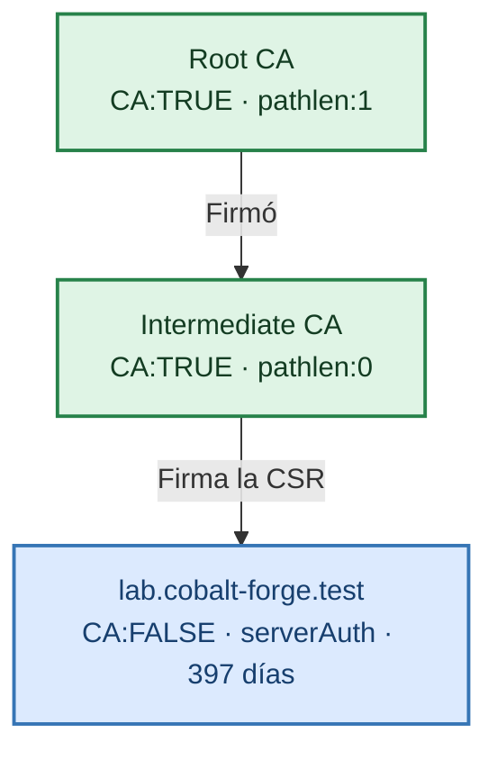

# Laboratorio: certificado de servidor TLS para `lab.cobalt-forge.test`

Con la Root CA (01) y la Intermediate CA (02) listas, emitiremos el **certificado final** del sitio de prueba. Lo firma la **Intermediate CA** y completa una cadena de tres niveles.

> **Requisito:** en `cert/` deben existir `rootCA.cert.pem`, `intermediateCA.cert.pem` e `intermediateCA.key.pem`. Todos los comandos se ejecutan **desde la raíz del proyecto**.
>
> **Solo para laboratorio.**



## 1. Preparar

```bash
export OPENSSL="$(brew --prefix openssl@3)/bin/openssl"
mkdir -p cert
umask 077
```

## 2. Generar la clave privada del servidor

```bash
$OPENSSL genpkey \
  -algorithm RSA \
  -pkeyopt rsa_keygen_bits:2048 \
  -out cert/lab.cobalt-forge.test.key.pem
```

- **Sin `-aes-256-cbc`:** el servidor debe leer la clave al arrancar sin que nadie escriba una contraseña. La protegeremos al empaquetarla en `.p12` (laboratorio 04) y con permisos de archivo.
- **RSA 2048:** suficiente para un certificado final de vida corta; las CAs usan 4096 porque viven más.
- Es una clave **nueva y propia**: nunca se reutiliza la de una CA.

## 3. Crear la CSR

```bash
$OPENSSL req -new \
  -sha256 \
  -key cert/lab.cobalt-forge.test.key.pem \
  -out cert/lab.cobalt-forge.test.csr.pem \
  -subj "/C=CO/ST=Bogota/L=Bogota/O=PKI Lab/CN=lab.cobalt-forge.test"
```

```bash
$OPENSSL req -in cert/lab.cobalt-forge.test.csr.pem -noout -subject -verify
```

Esperado: `Certificate request self-signature verify OK`.

## 4. Definir las extensiones del certificado de servidor

```bash
cat > cert/server.ext <<'EOF'
[v3_server]
basicConstraints = critical,CA:FALSE
keyUsage = critical,digitalSignature,keyEncipherment
extendedKeyUsage = serverAuth
subjectAltName = @alt_names
subjectKeyIdentifier = hash
authorityKeyIdentifier = keyid,issuer

[alt_names]
DNS.1 = lab.cobalt-forge.test
DNS.2 = localhost
IP.1 = 127.0.0.1
EOF
```

| Extensión | Para qué sirve |
|---|---|
| `basicConstraints = critical,CA:FALSE` | Es un certificado final: no puede firmar otros certificados. |
| `keyUsage = digitalSignature,keyEncipherment` | Usos de la clave durante el *handshake* TLS. |
| `extendedKeyUsage = serverAuth` | Solo sirve para **autenticar un servidor TLS**. macOS y los navegadores lo exigen. |
| `subjectAltName` | Nombres válidos del certificado. **Los navegadores ignoran el `CN`** y solo miran el SAN. |
| `subjectKeyIdentifier` / `authorityKeyIdentifier` | Enlazan el certificado con su clave y con la de la Intermediate CA. |

## 5. Firmar la CSR con la Intermediate CA

```bash
$OPENSSL x509 -req \
  -in cert/lab.cobalt-forge.test.csr.pem \
  -CA cert/intermediateCA.cert.pem \
  -CAkey cert/intermediateCA.key.pem \
  -CAserial cert/intermediateCA.srl \
  -CAcreateserial \
  -out cert/lab.cobalt-forge.test.cert.pem \
  -days 397 \
  -sha256 \
  -extfile cert/server.ext \
  -extensions v3_server
```

Se pedirá la contraseña de `intermediateCA.key.pem`.

- `-CA` / `-CAkey`: ahora el emisor es la **Intermediate CA**, no la raíz.
- `-CAserial cert/intermediateCA.srl`: control de series propio de la intermedia, separado del de la raíz.
- `-days 397`: Safari y Chrome rechazan certificados TLS con vigencias largas; 397 días es el máximo seguro.

## 6. Inspeccionar

```bash
$OPENSSL x509 \
  -in cert/lab.cobalt-forge.test.cert.pem \
  -noout -subject -issuer -dates \
  -ext subjectAltName,extendedKeyUsage,basicConstraints
```

Debe mostrar `issuer=... CN=Lab Intermediate CA` y el SAN con `DNS:lab.cobalt-forge.test, DNS:localhost, IP Address:127.0.0.1`.

Confirmar que clave y certificado corresponden (los hashes deben coincidir):

```bash
$OPENSSL pkey -in cert/lab.cobalt-forge.test.key.pem -pubout | $OPENSSL sha256
$OPENSSL x509 -in cert/lab.cobalt-forge.test.cert.pem -noout -pubkey | $OPENSSL sha256
```

## 7. Verificar la cadena completa

```bash
$OPENSSL verify \
  -CAfile cert/rootCA.cert.pem \
  -untrusted cert/intermediateCA.cert.pem \
  -purpose sslserver \
  -verify_hostname lab.cobalt-forge.test \
  -show_chain \
  cert/lab.cobalt-forge.test.cert.pem
```

- `-CAfile`: ancla de confianza (Root CA).
- `-untrusted`: certificado intermedio para **construir** la cadena; no se confía en él directamente.
- `-purpose sslserver` y `-verify_hostname`: comprueban, como haría un navegador, que sirve para un servidor TLS con ese nombre.

Esperado:

```text
cert/lab.cobalt-forge.test.cert.pem: OK
Chain:
depth=0: ... CN=lab.cobalt-forge.test (untrusted)
depth=1: ... CN=Lab Intermediate CA (untrusted)
depth=2: ... CN=Lab Root CA
```

## 8. Permisos

```bash
chmod 400 cert/lab.cobalt-forge.test.key.pem
chmod 444 cert/lab.cobalt-forge.test.cert.pem cert/lab.cobalt-forge.test.csr.pem cert/server.ext
```

| Archivo nuevo en `cert/` | Contenido |
|---|---|
| `lab.cobalt-forge.test.key.pem` | Clave privada del servidor (sin cifrar) |
| `lab.cobalt-forge.test.csr.pem` | Solicitud de firma |
| `server.ext` | Extensiones X.509 v3 del servidor |
| `lab.cobalt-forge.test.cert.pem` | Certificado firmado por la Intermediate CA |
| `intermediateCA.srl` | Control de serie de la Intermediate CA |

## 9. Siguiente laboratorio

[Empaquetar clave y certificados en PKCS#12](04-pkcs12-keystore.md) para que Spring Boot los cargue.

## Referencias oficiales

- [OpenSSL 3 — x509v3_config](https://docs.openssl.org/3.0/man5/x509v3_config/)
- [OpenSSL 3 — openssl-verify](https://docs.openssl.org/3.6/man1/openssl-verify/)
