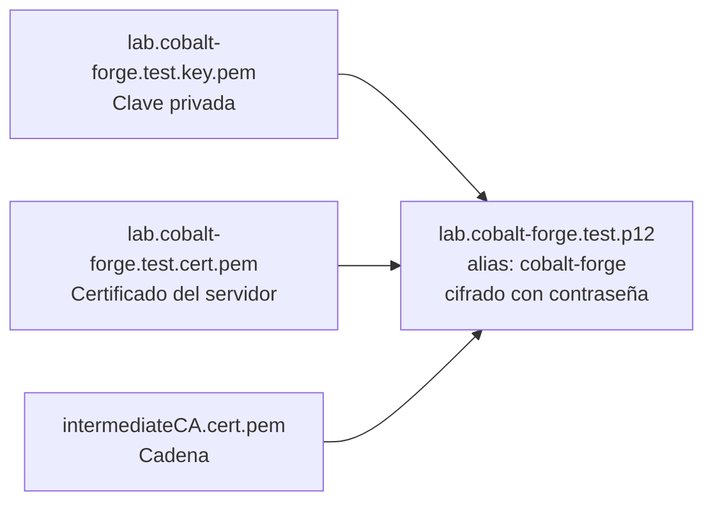

# Laboratorio: empaquetar el certificado en PKCS#12 (`.p12`)

Java y Spring Boot cargan cómodamente un **keystore PKCS#12**: un solo archivo, protegido con contraseña, que contiene la **clave privada**, el **certificado del servidor** y la **cadena** (Intermediate CA).

> **Requisito:** haber completado el laboratorio 03. Comandos desde la **raíz del proyecto**.



La Root CA **no** va dentro: el servidor no la envía; el cliente debe tenerla en su propio almacén de confianza (laboratorio 07).

## 1. Crear el `.p12`

```bash
export OPENSSL="$(brew --prefix openssl@3)/bin/openssl"
umask 077

$OPENSSL pkcs12 -export \
  -inkey cert/lab.cobalt-forge.test.key.pem \
  -in cert/lab.cobalt-forge.test.cert.pem \
  -certfile cert/intermediateCA.cert.pem \
  -name cobalt-forge \
  -out cert/lab.cobalt-forge.test.p12
```

OpenSSL pedirá una **Export Password**: será la contraseña del keystore que usará Spring Boot. Guárdala; no se puede recuperar.

- `-export`: crea un PKCS#12 (en lugar de leerlo).
- `-inkey` / `-in`: clave privada y certificado del servidor; deben corresponder entre sí.
- `-certfile`: certificados adicionales de la cadena. **Si falta la intermedia**, el servidor enviará solo su certificado y el navegador no podrá llegar a la Root CA.
- `-name cobalt-forge`: **alias** de la entrada; Spring Boot lo usa como `key-alias`.

> OpenSSL 3 cifra el `.p12` con AES-256 y PBKDF2 por defecto; Java 21 lo lee sin problemas. La opción `-legacy` solo haría falta para Java muy antiguo.

## 2. Inspeccionar con OpenSSL

```bash
$OPENSSL pkcs12 \
  -in cert/lab.cobalt-forge.test.p12 \
  -info -nokeys
```

Pide la contraseña y muestra los dos certificados (`subject=...CN=lab.cobalt-forge.test` e `issuer`, luego `CN=Lab Intermediate CA`). `-nokeys` evita imprimir la clave privada.

## 3. Inspeccionar con `keytool` (Java)

`keytool` viene con el JDK 21 instalado en el laboratorio 0:

```bash
keytool -list -v \
  -keystore cert/lab.cobalt-forge.test.p12 \
  -storetype PKCS12
```

Resultado esperado (resumido):

```text
Keystore type: PKCS12
Your keystore contains 1 entry

Alias name: cobalt-forge
Entry type: PrivateKeyEntry
Certificate chain length: 2
Certificate[1]:
Owner: CN=lab.cobalt-forge.test, ...
Issuer: CN=Lab Intermediate CA, ...
Certificate[2]:
Owner: CN=Lab Intermediate CA, ...
Issuer: CN=Lab Root CA, ...
```

| Qué revisar | Por qué |
|---|---|
| `Alias name: cobalt-forge` | Debe coincidir con `key-alias` en Spring Boot. |
| `Entry type: PrivateKeyEntry` | La clave privada está dentro (no es solo un certificado). |
| `Certificate chain length: 2` | Incluye servidor + intermedia. Si es `1`, faltó `-certfile`. |

## 4. Permisos

```bash
chmod 400 cert/lab.cobalt-forge.test.p12
```

Solo tu usuario puede leerlo, que es el mismo usuario que ejecutará la aplicación.

## 5. Siguiente laboratorio

[Crear el dominio local en `hosts`](05-hosts-dominio-local.md).

## Referencias oficiales

- [OpenSSL 3 — openssl-pkcs12](https://docs.openssl.org/3.0/man1/openssl-pkcs12/)
- [JDK 21 — keytool](https://docs.oracle.com/en/java/javase/21/docs/specs/man/keytool.html)
