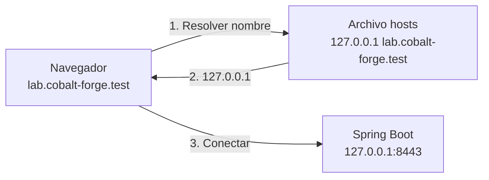

# Laboratorio: dominio local `lab.cobalt-forge.test` en `hosts`

El certificado del laboratorio 03 es válido para `lab.cobalt-forge.test`. Para que el navegador use ese nombre, debe resolverse a nuestra máquina (`127.0.0.1`). Lo haremos con el archivo **`hosts`**, que el sistema consulta antes que el DNS.

> **¿Por qué `.test`?** Es un dominio de nivel superior **reservado** para pruebas (RFC 6761): nunca existirá en Internet. Evita `.local` (lo usa mDNS/Bonjour) y `.dev` (es un dominio real que fuerza HTTPS).



## 1. macOS

Agregar la entrada (requiere contraseña de administrador):

```bash
echo "127.0.0.1 lab.cobalt-forge.test" | sudo tee -a /etc/hosts
```

- `tee -a`: **agrega** al final; no reemplaza el archivo. (`sudo echo ... >> /etc/hosts` no funciona: la redirección no corre como root.)

Vaciar la caché DNS para que el cambio se vea de inmediato:

```bash
sudo dscacheutil -flushcache
sudo killall -HUP mDNSResponder
```

Verificar:

```bash
grep cobalt-forge /etc/hosts
dscacheutil -q host -a name lab.cobalt-forge.test
ping -c 1 lab.cobalt-forge.test
```

Esperado: `ip_address: 127.0.0.1` y `PING lab.cobalt-forge.test (127.0.0.1)`.

## 2. Windows

Abrir **PowerShell como administrador** (clic derecho → *Ejecutar como administrador*):

```powershell
Add-Content `
  -Path "$env:windir\System32\drivers\etc\hosts" `
  -Value "127.0.0.1 lab.cobalt-forge.test"

ipconfig /flushdns
```

Verificar (no requiere administrador):

```powershell
Select-String cobalt-forge "$env:windir\System32\drivers\etc\hosts"
ping -n 1 lab.cobalt-forge.test
```

Esperado: `Haciendo ping a lab.cobalt-forge.test [127.0.0.1]`.

> Si el antivirus bloquea el cambio, edita el archivo con el Bloc de notas abierto como administrador.

## 3. Quitar la entrada al terminar

- **macOS:** `sudo sed -i '' '/lab\.cobalt-forge\.test/d' /etc/hosts` y vaciar la caché.
- **Windows:** editar `hosts` como administrador, borrar la línea y `ipconfig /flushdns`.

## 4. Siguiente laboratorio

[Levantar Spring Boot con HTTPS](06-https-spring-boot.md).
