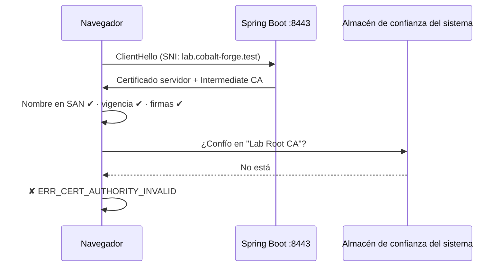

# Laboratorio: levantar Cobalt Forge con HTTPS en Spring Boot

Configuraremos el Tomcat embebido de Spring Boot para servir el sitio por **HTTPS** con el keystore `.p12` del laboratorio 04. Al final veremos la **advertencia de sitio no seguro**: es lo esperado, porque el sistema aún no confía en nuestra Root CA.

> **Requisitos:** laboratorios 00 (Java 21), 03, 04 y 05 completados.

## 1. Crear el perfil `https`

Crear `web-java/src/main/resources/application-https.yml`:

```yaml
server:
  port: 8443
  ssl:
    key-store: file:../cert/lab.cobalt-forge.test.p12
    key-store-type: PKCS12
    key-store-password: ${COBALT_FORGE_P12_PASSWORD}
    key-alias: cobalt-forge
```

| Propiedad | Función |
|---|---|
| `server.port: 8443` | Puerto HTTPS. Al ser mayor que 1024 no requiere administrador. |
| `key-store` | Ruta al `.p12`. `file:../cert/` es **relativa a `web-java/`**, el directorio desde donde se ejecuta `mvnw`. |
| `key-store-type` | Formato del keystore. |
| `key-store-password` | Se toma de la variable de entorno `COBALT_FORGE_P12_PASSWORD`: la contraseña **no** queda en el código. |
| `key-alias` | Entrada del keystore a usar (`-name` del laboratorio 04). |

Al ser un **perfil**, el modo HTTP del laboratorio 0 sigue funcionando igual; HTTPS solo se activa al pedirlo.

## 2. Arrancar con HTTPS

**macOS:**

```bash
cd web-java
read -s "COBALT_FORGE_P12_PASSWORD?Contraseña del .p12: "; echo
export COBALT_FORGE_P12_PASSWORD

./mvnw spring-boot:run -Dspring-boot.run.profiles=https
```

`read -s` lee la contraseña sin mostrarla ni guardarla en el historial de la terminal (sintaxis de `zsh`).

**Windows (PowerShell):**

```powershell
cd web-java
$env:COBALT_FORGE_P12_PASSWORD = Read-Host "Contraseña del .p12"

.\mvnw.cmd spring-boot:run "-Dspring-boot.run.profiles=https"
```

En el log debe aparecer:

```text
The following 1 profile is active: "https"
Tomcat started on port 8443 (https) with context path '/'
```

## 3. Probar desde la terminal

En otra terminal, desde la **raíz del proyecto**:

```bash
export OPENSSL="$(brew --prefix openssl@3)/bin/openssl"

$OPENSSL s_client \
  -connect lab.cobalt-forge.test:8443 \
  -servername lab.cobalt-forge.test \
  -showcerts </dev/null
```

- `-servername`: envía el nombre (SNI), como hace un navegador.
- `-showcerts`: muestra los certificados que envía el servidor. Deben ser **dos**: `CN=lab.cobalt-forge.test` y `CN=Lab Intermediate CA`.

Al final verás `Verify return code: 20 (unable to get local issuer certificate)`: OpenSSL no conoce nuestra Root CA. Indicándola explícitamente:

```bash
$OPENSSL s_client \
  -connect lab.cobalt-forge.test:8443 \
  -servername lab.cobalt-forge.test \
  -verify_hostname lab.cobalt-forge.test \
  -CAfile cert/rootCA.cert.pem </dev/null | grep "Verify return code"
```

Esperado: `Verify return code: 0 (ok)`. Lo mismo con `curl`:

```bash
curl -I https://lab.cobalt-forge.test:8443                                  # falla: emisor desconocido
curl -I --cacert cert/rootCA.cert.pem https://lab.cobalt-forge.test:8443    # HTTP/1.1 200
```

## 4. Probar en el navegador: la advertencia

Abre <https://lab.cobalt-forge.test:8443>. Verás:

- **Chrome / Edge:** *La conexión no es privada* — `NET::ERR_CERT_AUTHORITY_INVALID`.
- **Safari:** *Esta conexión no es privada*.
- **Firefox:** *Advertencia: riesgo potencial de seguridad* — `SEC_ERROR_UNKNOWN_ISSUER`.



El certificado, el nombre y la cadena **están bien** (lo comprobó `s_client` con `-CAfile`); lo único que falta es el **ancla de confianza**. Puedes inspeccionar el certificado desde la advertencia (clic en *No seguro* → certificado) y ver los tres niveles.

## 5. Problemas comunes

| Error | Causa probable |
|---|---|
| `Could not resolve placeholder 'COBALT_FORGE_P12_PASSWORD'` | No se exportó la variable en esa terminal. |
| `keystore password was incorrect` | Contraseña distinta a la *Export Password* del laboratorio 04. |
| `FileNotFoundException ... lab.cobalt-forge.test.p12` | `mvnw` no se ejecutó desde `web-java/`, o el `.p12` no existe. |
| `Alias name [cobalt-forge] does not identify a key entry` | El `-name` del `.p12` es otro. Revisa con `keytool -list`. |
| `NET::ERR_CERT_COMMON_NAME_INVALID` | Abriste otro nombre (o una IP) que no está en el SAN. |
| `ERR_NAME_NOT_RESOLVED` | Falta la entrada en `hosts` (laboratorio 05). |
| `Port 8443 was already in use` | Otra instancia sigue corriendo. |

## 6. Siguiente laboratorio

[Confiar en la Root CA](07-confiar-root-ca.md) para que desaparezca la advertencia.

## Referencias oficiales

- [Spring Boot — Configure SSL](https://docs.spring.io/spring-boot/how-to/webserver.html#howto.webserver.configure-ssl)
- [OpenSSL 3 — openssl-s_client](https://docs.openssl.org/3.0/man1/openssl-s_client/)
