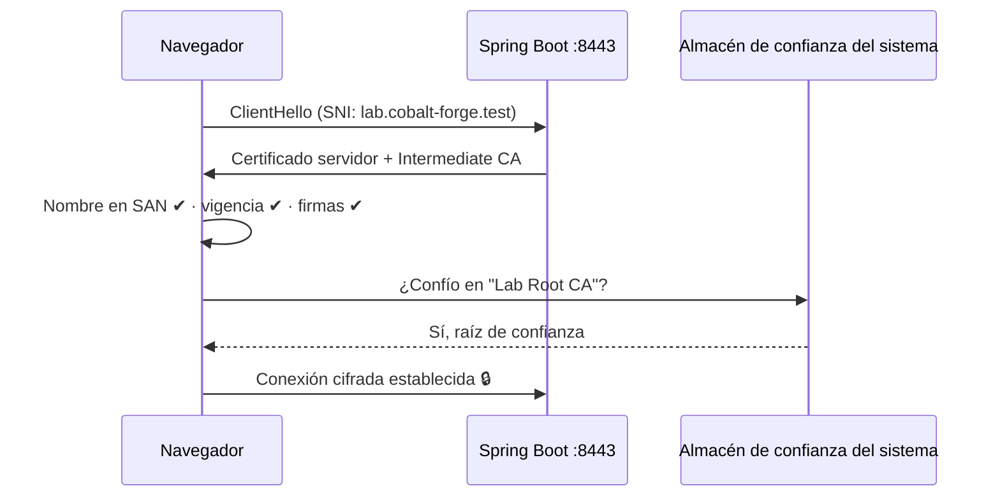
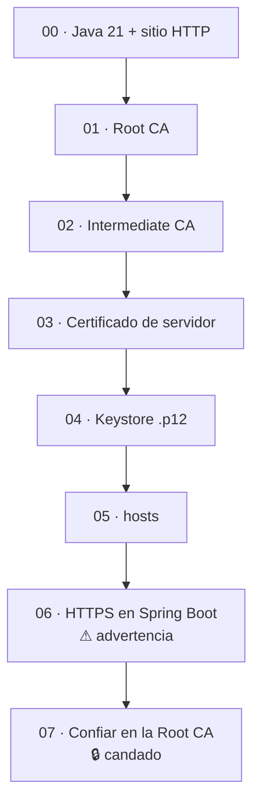

# Laboratorio: confiar en la Root CA y ver el candado

El último paso es agregar **solo la Root CA** al almacén de confianza del sistema. Desde ese momento, el navegador acepta cualquier certificado que encadene hasta ella, incluido el de `lab.cobalt-forge.test`.

> ⚠️ **Riesgo:** confiar en una CA propia significa que **quien tenga `rootCA.key.pem` puede suplantar cualquier sitio** ante tu equipo. Protege `cert/` y quita la CA cuando termines el laboratorio (sección 4).
>
> Se confía **únicamente en la raíz**, nunca en la intermedia ni en el certificado del servidor: la raíz es el ancla; el resto se valida por la cadena.

## 1. macOS

Agregar la Root CA al llavero **de tu usuario** (no al del sistema), marcándola como raíz confiable:

```bash
security add-trusted-cert \
  -r trustRoot \
  -k ~/Library/Keychains/login.keychain-db \
  cert/rootCA.cert.pem
```

macOS pedirá tu contraseña (o Touch ID) para modificar la configuración de confianza.

- `-r trustRoot`: la marca como **raíz** de confianza.
- `-k ...login.keychain-db`: llavero de inicio de sesión; afecta solo a tu usuario y no requiere `sudo`.

Verificar que macOS ahora valida la cadena del servidor:

```bash
security verify-cert \
  -c cert/lab.cobalt-forge.test.cert.pem \
  -c cert/intermediateCA.cert.pem \
  -p ssl \
  -s lab.cobalt-forge.test
```

Esperado: `...certificate verification successful.`

- `-c` (dos veces): certificado del servidor primero y luego la intermedia.
- `-p ssl -s ...`: valida con la política TLS para ese nombre, como haría Safari.

También puedes verla en **Acceso a Llaveros** → *Inicio de sesión* → *Certificados* → `Lab Root CA` (icono con `+` azul y *"Este certificado está marcado como de confianza para esta cuenta"*).

## 2. Windows

En PowerShell (sin administrador), desde la raíz del proyecto:

```powershell
certutil -user -addstore Root cert\rootCA.cert.pem
```

Windows mostrará una **advertencia de seguridad** con la huella del certificado: compárala con la de `openssl x509 -fingerprint -sha1` (laboratorio 01) y confirma.

- `-user`: almacén del usuario actual, no de toda la máquina.
- `Root`: *Entidades de certificación raíz de confianza*.

Verificar:

```powershell
certutil -user -store Root "Lab Root CA"
```

## 3. Probar en el navegador

1. **Cierra y vuelve a abrir el navegador** (Chrome y Edge cachean la validación).
2. Arranca la aplicación con el perfil `https` (laboratorio 06).
3. Abre <https://lab.cobalt-forge.test:8443>.

Resultado: **candado sin advertencias** y la tarjeta *Protocolo* en verde con **HTTPS**. En el visor del certificado se ve la jerarquía completa:

```text
Lab Root CA
└── Lab Intermediate CA
    └── lab.cobalt-forge.test
```



> **Firefox** puede usar su propio almacén. Si sigue mostrando la advertencia: *Ajustes → Privacidad y seguridad → Certificados → Ver certificados → Autoridades → Importar* `rootCA.cert.pem`, marcando *"Confiar en esta CA para identificar sitios web"*.

## 4. Quitar la confianza al terminar

**macOS:**

```bash
security delete-certificate \
  -c "Lab Root CA" \
  ~/Library/Keychains/login.keychain-db
```

**Windows:**

```powershell
certutil -user -delstore Root "Lab Root CA"
```

Después, vuelve a abrir <https://lab.cobalt-forge.test:8443>: la advertencia del laboratorio 06 debe reaparecer. Quita también la entrada de `hosts` (laboratorio 05, sección 3).

## 5. Recorrido completo



## Referencias oficiales

- [Apple — security(1)](https://ss64.com/mac/security.html)
- [Microsoft — certutil](https://learn.microsoft.com/windows-server/administration/windows-commands/certutil)
